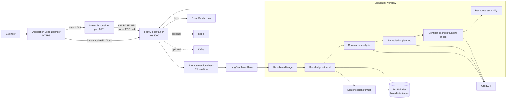
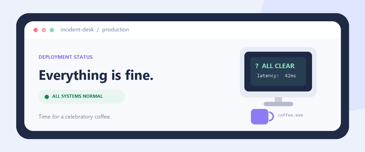

# AI Incident Resolution Platform

## Project summary

This Python application helps an SRE or operations engineer investigate an IT incident. A user submits an incident description through a Streamlit web UI or the FastAPI endpoint. A LangGraph workflow classifies the incident, retrieves relevant passages from a local knowledge base, asks a Groq-hosted language model to suggest a root cause and remediation plan, and returns a confidence score and human-review flag.

It is an **incident-analysis assistant**, not an autonomous repair system: recommendations are returned for an engineer to review; the application does not change production systems, open tickets, or route a case to a human-review queue.

## Demo video

<p align="center">
  <video src="./brag-output-2026-10-26-092043/brag.mp4" width="720" controls playsinline muted></video>
</p>

This short launch video shows the Incident Desk flow for a sample payment API timeout incident, from intake through triage, investigation, and engineer-review guidance.

## Business problem it addresses

When a service fails, responders often spend valuable time manually sorting incident reports, finding relevant runbooks or past knowledge, forming a root-cause hypothesis, and deciding what to investigate next. This creates operational toil, inconsistent triage, repeated investigation of similar symptoms, and potentially longer mean time to resolution (MTTR).

The project brings those early investigation steps into one workflow. It can give responders a consistent initial severity/domain classification, surface related knowledge, and provide a draft explanation and remediation checklist. The goal is to help engineers start an investigation faster—not to guarantee a correct diagnosis or replace incident response procedures.

## Contents

- [Architecture](#architecture)
- [End-to-End Workflow](#end-to-end-workflow)
- [AI Governance and Responsible AI](#ai-governance-and-responsible-ai)
- [Observability and Monitoring](#observability-and-monitoring)
- [Technology Stack](#technology-stack)
- [Project Structure](#project-structure)
- [Run Locally](#run-locally)
- [Deploy to AWS ECS Fargate](#deploy-to-aws-ecs-fargate)

## Architecture



The AWS guide below deploys the UI and API as two containers in one ECS Fargate task. In Fargate's `awsvpc` mode, the containers share the task network, allowing the UI to call the API at `http://127.0.0.1:8000`. The ALB exposes the UI and routes API paths to FastAPI. The FAISS index and embedding model are built into the Docker image. Redis and Kafka are optional integrations and are not required by the baseline AWS deployment.

## Incident analysis flow

1. The API rejects descriptions that match its prompt-injection checks and masks email, phone, and IP patterns.
2. The triage agent uses keyword rules to assign severity, priority, and domain.
3. The retrieval agent embeds the masked description and searches the local FAISS index built from `data/knowledge_base.txt`.
4. The RCA and planner agents call the configured Groq model.
5. The validation agent asks the model whether the root-cause answer is supported by retrieved context, calculates a confidence score, and flags results needing review.
6. The execution agent assembles the JSON response. The API optionally stores it in Redis and publishes a Kafka event when those integrations are available.

The human-review flag is informational only. It does not trigger a ticket, notification, or approval workflow. Triage is currently a simple keyword classifier, and validation is an LLM-based check rather than a formal guarantee.

---

# End-to-End Workflow

An incident is submitted through the Streamlit UI or the `POST /incident` API endpoint. The API then runs it through the following stages:

| Step | Stage | What happens |
| --- | --- | --- |
| 1 | Incident intake | The API accepts an incident ID, title, and description. |
| 2 | Security checks | Known prompt-injection phrases are rejected. Regex-based masking replaces detected email addresses, phone numbers, and IPv4-shaped strings before the description is passed through the workflow. |
| 3 | Triage | Keyword-based rules assign severity, priority, and business domain. |
| 4 | Knowledge retrieval | The masked description is embedded and used to retrieve relevant passages from the local FAISS index. |
| 5 | Root-cause analysis | The RCA agent uses the incident and retrieved context to produce a concise hypothesis with the configured Groq model. |
| 6 | Remediation planning | The planner generates a proposed list of investigation or remediation steps. |
| 7 | Validation | The validation agent checks whether the root-cause hypothesis is supported by retrieved context and calculates a confidence score. |
| 8 | Response assembly | The execution agent returns the incident classification, analysis, suggested plan, confidence, review flag, and prompt versions as JSON. |

### Example incident

```text
Payment API timeout after deployment.
Customer john@test.com unable to complete transaction.
```

The email is masked before analysis:

```text
Payment API timeout after deployment.
Customer [EMAIL_MASKED] unable to complete transaction.
```

### Example API response

```json
{
  "incident_id": "INC-1005",
  "severity": "HIGH",
  "domain": "Payments",
  "priority": "P1",
  "root_cause": "Possible database connection pool exhaustion.",
  "remediation_plan": [
    "Check payment service database connection-pool usage.",
    "Compare database connection limits with current demand."
  ],
  "confidence_score": 0.83,
  "hallucination_detected": false,
  "requires_human_review": false,
  "prompt_versions": {
    "rca": "v1.0.0",
    "planner": "v1.0.0"
  }
}
```

The values above are illustrative. Triage uses keyword rules, and the validation and confidence checks are safeguards—not guarantees that a diagnosis or recommendation is correct.

## Multi-Agent Responsibilities

| Agent | Responsibility |
| --- | --- |
| Triage | Assigns severity, priority, and business domain using keyword rules. |
| Retrieval | Searches the local vector index for relevant knowledge-base passages. |
| RCA | Produces a root-cause hypothesis using the incident and retrieved context. |
| Planner | Suggests investigation or remediation steps. |
| Validation | Checks grounding, estimates confidence, and determines whether human review is recommended. |
| Execution | Assembles the final response returned by the API. |

# AI Governance and Responsible AI

The platform provides basic input protections and output checks. These controls are deliberately limited and should not be treated as a substitute for security review or an engineer's judgment.

| Control | Current behavior | Important limitation |
| --- | --- | --- |
| PII masking | Regex rules replace detected email addresses, phone numbers, and IPv4-shaped strings with masking labels. | Pattern matching can miss sensitive data or mask text that is not personal information. Do not submit credentials or secrets. |
| Prompt-injection checks | The API rejects descriptions containing configured suspicious phrases, such as “ignore previous instructions.” | This is a small phrase list, not comprehensive prompt-injection protection. |
| Hallucination check | The configured Groq model checks whether the root-cause response is supported by retrieved context. | This is an LLM-based judgment and is not a formal correctness guarantee. |
| Confidence score | A score is calculated from retrieval and validation scores, with a penalty when hallucination is detected. | The current values are heuristic and should not be interpreted as calibrated probabilities. |
| Human-review flag | `requires_human_review` is `true` if hallucination is detected or confidence is below `0.80`. | The flag is informational; the application does not create a ticket, notify a reviewer, or send results to a review queue. |
| Prompt versions | The RCA and planner prompt versions are included in the API response for traceability. | Version strings identify the prompts; they do not guarantee response quality. |

The project is an incident-analysis assistant, not an autonomous repair system. Engineers should verify the analysis and recommendations against current system evidence and operational procedures before acting.

# Observability and Monitoring

The application exposes Prometheus metrics on port `8001`:

| Metric | Type | Description |
| --- | --- | --- |
| `incident_requests_total` | Counter | Number of incident requests processed. |
| `incident_latency_seconds` | Histogram | Time spent processing incident requests. |

Grafana dashboard configuration is included under `monitoring/`; a Grafana deployment is not part of the baseline local run or AWS guide.

# Technology Stack

| Area | Technology |
| --- | --- |
| Language and API | Python, FastAPI |
| Agent workflow | LangGraph, LangChain |
| Language model | Groq API (default model: `llama-3.3-70b-versatile`) |
| Embeddings and vector search | Sentence Transformers, FAISS |
| Web UI | Streamlit |
| Memory | Redis (optional integration) |
| Event streaming | Kafka (optional integration) |
| Metrics | Prometheus client |
| Container deployment | Docker, AWS ECS Fargate |

---

# Project Structure

```text
ai-incident-resolution-platform/

├── app/
│   ├── agents/
│   ├── api/
│   ├── core/
│   ├── events/
│   ├── governance/
│   ├── graph/
│   ├── memory/
│   ├── monitoring/
│   ├── observability/
│   ├── prompts/
│   ├── security/
│   └── services/
│
├── data/
├── evaluation/
├── monitoring/
├── ui/
├── ingest_data.py
├── main.py
├── requirements.txt
└── README.md
```

---

# Run locally

Requirements: Python 3.11+, a Groq API key, and internet access for the initial sentence-transformer model download.

```powershell
python -m venv .venv
.\.venv\Scripts\Activate.ps1
python -m pip install --upgrade pip
pip install -r requirements.txt
Copy-Item .env.example .env
```

Set `GROQ_API_KEY` in `.env` (and optionally `MODEL_NAME`, default `llama-3.3-70b-versatile`), then build the FAISS index and start the API:

```powershell
python ingest_data.py
uvicorn main:app --host 0.0.0.0 --port 8000
```

In another terminal, activate the same environment and start the UI:

```powershell
streamlit run ui/streamlit_app.py
```

Open `http://localhost:8501`. The API health endpoint and Swagger docs are at `http://localhost:8000/health` and `http://localhost:8000/docs`.

# Deploy to AWS (ECS Fargate)

This guide deploys the Streamlit UI and FastAPI API as two containers in one ECS Fargate task, stores the image in Amazon ECR, keeps the Groq key in Secrets Manager, sends logs to CloudWatch, and uses an Application Load Balancer (ALB). It is a small single-task deployment; the API, local memory, and FAISS index are not a highly available or durable multi-instance production design.

## What you need

- An AWS account with permission to create ECR, ECS, IAM roles/policies, Secrets Manager, VPC/security groups, ALB, and CloudWatch resources.
- AWS CLI v2 configured for the account (prefer AWS IAM Identity Center/SSO over long-lived access keys).
- Docker Desktop running on your computer.
- A Groq API key.
- For HTTPS: a domain name and an ACM certificate in the same AWS region as the ALB. For a temporary test, HTTP can be used, but do not send real incident data over public HTTP.

All AWS CLI examples below use Windows PowerShell. In a terminal at the repository root, confirm the AWS identity and choose a region:

```powershell
aws sts get-caller-identity
$AWS_REGION = "ap-south-1"
$ACCOUNT_ID = aws sts get-caller-identity --query Account --output text
$REPOSITORY = "incident-resolution-platform"
$ECR_URI = "$($ACCOUNT_ID).dkr.ecr.$($AWS_REGION).amazonaws.com/$($REPOSITORY)"
```

Use one region consistently. Replace `ap-south-1` if you deploy elsewhere.

## 1. Build and publish the Docker image

The Dockerfile installs Python dependencies and runs `ingest_data.py` during the image build. That creates the FAISS index and its document metadata inside the image, and downloads the sentence-transformer weights. The build therefore needs internet access and can take several minutes.

Create an ECR repository:

```powershell
aws ecr create-repository `
  --repository-name $REPOSITORY `
  --image-scanning-configuration scanOnPush=true `
  --region $AWS_REGION
```

If it already exists, continue. Log Docker in, build an x86-64 Linux image for Fargate, tag it, and push it:

```powershell
aws ecr get-login-password --region $AWS_REGION |
  docker login --username AWS --password-stdin "$($ACCOUNT_ID).dkr.ecr.$($AWS_REGION).amazonaws.com"

$IMAGE_TAG = "v1"
docker build --platform linux/amd64 -t "${REPOSITORY}:$IMAGE_TAG" .
docker tag "${REPOSITORY}:$IMAGE_TAG" "${ECR_URI}:$IMAGE_TAG"
docker push "${ECR_URI}:$IMAGE_TAG"
```

If Docker reports that it cannot connect to the daemon, start Docker Desktop and repeat the build/push commands.

## 2. Store the Groq key in AWS Secrets Manager

1. Open **AWS Secrets Manager** in the selected region and choose **Store a new secret**.
2. Select **Other type of secret** and enter the Groq API key as the secret value. Do not put the key in the Docker image, README, task-definition plain-text environment variables, or source control.
3. Name the secret `incident-resolution/groq-api-key`, create it, and copy its **Secret ARN**.
4. You can rotate/update this secret later; force a new ECS deployment after changing it so new tasks receive the latest value.

## 3. Create the ECS task execution role

The ECS **task execution role** lets ECS pull the private ECR image, write container logs, and fetch the Groq secret. It is not the application task role.

1. In **IAM → Roles**, create a role for **Elastic Container Service → ECS Task**.
2. Attach `AmazonECSTaskExecutionRolePolicy`.
3. Add an inline policy allowing `secretsmanager:GetSecretValue` on only the secret ARN created in step 2. If the secret uses a customer-managed KMS key, also allow `kms:Decrypt` on that key.
4. Name the role `ecsIncidentResolutionExecutionRole` and note it for the task definition.

Example inline policy (replace the ARN with the actual secret ARN):

```json
{
  "Version": "2012-10-17",
  "Statement": [
    {
      "Effect": "Allow",
      "Action": "secretsmanager:GetSecretValue",
      "Resource": "arn:aws:secretsmanager:ap-south-1:123456789012:secret:incident-resolution/groq-api-key-AbCdEf"
    }
  ]
}
```

## 4. Set up the VPC and security groups

For a first deployment, use a VPC with at least two public subnets in different Availability Zones. Place the internet-facing ALB in those subnets. You can run the Fargate task in a public subnet with **Assign public IP** enabled to avoid NAT Gateway costs; the task must still have no public inbound access. For a production network, place tasks in private subnets and provide outbound internet access through a NAT Gateway or the required VPC endpoints.

Create two security groups:

1. **ALB security group**: allow inbound TCP 443 from the intended client IP ranges (or `0.0.0.0/0` for a public site); allow TCP 80 only if it will redirect to HTTPS. Leave outbound traffic allowed.
2. **ECS task security group**: allow inbound TCP **8501** and **8000**, with the **ALB security group as the source** for both rules. Do not allow these ports from the internet. Do not open metrics port 8001. Allow outbound HTTPS (TCP 443) so the task can reach Groq and AWS services.

The containers communicate over the shared task network. Port 8000 is exposed externally only through the ALB rule in the next steps.

## 5. Create target groups and the Application Load Balancer

In **EC2 → Target Groups**, create two target groups in the same VPC. For both, choose target type **IP addresses** (required for Fargate):

| Target group | Protocol/port | Health-check path | Purpose |
|---|---:|---|---|
| `incident-ui-tg` | HTTP : 8501 | `/_stcore/health` | Streamlit |
| `incident-api-tg` | HTTP : 8000 | `/health` | FastAPI |

Create an **internet-facing Application Load Balancer** in the two public subnets and attach the ALB security group. Add an HTTPS listener on port 443 with a valid ACM certificate. Add an HTTP listener on port 80 that redirects to HTTPS, or omit it for a temporary HTTP-only test. Set the ALB idle timeout to at least `300` seconds so slower model responses are less likely to be cut off.

On the HTTPS listener, add a forwarding rule with a priority (for example, 10) for these path patterns:

```text
/incident
/health
/docs*
/openapi.json
/redoc*
```

Forward that rule to `incident-api-tg`. Set the listener's default action to forward to `incident-ui-tg`. This sends browser traffic to Streamlit while making the API and Swagger docs available on the same ALB hostname.

## 6. Create the ECS cluster and task definition

1. In **Amazon ECS → Clusters**, create a cluster using the **AWS Fargate** infrastructure.
2. In **CloudWatch → Log groups**, create `/ecs/incident-resolution` in the selected region and set a retention period (for example, 30 days).
3. Choose **Task definitions → Create new task definition**. Select **AWS Fargate**, Linux/X86_64, and `awsvpc` networking.
4. Set task CPU to **2 vCPU** and memory to **4 GB** as a starting point. Increase memory if the embedding model or Python dependencies cause out-of-memory restarts. Use the execution role from step 3. No application task role is needed for the baseline.
5. Add these two containers to the same task definition. Use the same ECR image URI and tag for both:

   **Container `incident-api`**

   - Image: `${ECR_URI}:v1` (enter the actual full ECR URI and tag).
   - Port mapping: container port `8000`, protocol TCP.
   - Environment: `MODEL_NAME=llama-3.3-70b-versatile`, `LOG_LEVEL=INFO`.
   - Secret: environment name `GROQ_API_KEY`, value from the Secrets Manager ARN copied in step 2.
   - Health check command:
     ```text
     CMD-SHELL, python -c "import urllib.request; urllib.request.urlopen('http://127.0.0.1:8000/health', timeout=5).read()" || exit 1
     ```
   - Set health-check start period to `180` seconds so the model and application can finish loading.
   - Configure `awslogs` using a new log group such as `/ecs/incident-resolution`, region `$AWS_REGION`, and stream prefix `api`.

   **Container `incident-ui`**

   - Image: the same full ECR image URI and tag.
   - Command (overrides the Dockerfile's default API command):
     ```json
     ["streamlit", "run", "ui/streamlit_app.py", "--server.address=0.0.0.0", "--server.port=8501"]
     ```
   - Port mapping: container port `8501`, protocol TCP.
   - Environment: `API_BASE_URL=http://127.0.0.1:8000`.
   - Container dependency: start after `incident-api` is **HEALTHY**.
   - Health check command:
     ```text
     CMD-SHELL, python -c "import urllib.request; urllib.request.urlopen('http://127.0.0.1:8501/_stcore/health', timeout=5).read()" || exit 1
     ```
   - Set health-check start period to `60` seconds.
   - Configure `awslogs` with the same log group and stream prefix `ui`.

6. Save the task definition. ECS injects the secret at task start; it is not stored in the image.

The command and health-check fields above are arrays/commands in the ECS console; enter each container's health check as a `CMD-SHELL` command. Ensure the API health check passes before relying on the UI's `HEALTHY` startup dependency.

## 7. Create and start the ECS service

1. From the cluster, choose **Create service**, launch type/capacity provider **Fargate**, and select the task definition and revision from step 6.
2. Set desired tasks to `1` for a trial deployment. A single task is not highly available.
3. Select the VPC, at least two subnets, and the ECS task security group from step 4. For the public-subnet setup, enable **Auto-assign public IP**. For private subnets, ensure NAT/VPC endpoints provide image, logs, secrets, and Groq connectivity.
4. In **Load balancing**, select the ALB from step 5. Add both target groups and map `incident-ui` port `8501` to `incident-ui-tg` and `incident-api` port `8000` to `incident-api-tg`.
5. Create the service and wait until the task is **RUNNING** and both target groups report healthy targets.

## 8. Verify the deployment

Copy the ALB DNS name from **EC2 → Load Balancers** and open it over HTTPS (or HTTP for a temporary test). Test:

- `https://<ALB-DNS>/` — Streamlit interface.
- `https://<ALB-DNS>/health` — FastAPI health response.
- `https://<ALB-DNS>/docs` — FastAPI Swagger UI.

Submit a sample incident in the UI, or call the API directly:

```powershell
$ALB_URL = "https://your-domain.example.com"
Invoke-RestMethod -Method Post -Uri "$ALB_URL/incident" `
  -ContentType "application/json" `
  -Body '{"incident_id":"INC-1005","title":"Payment API Failure","description":"Payment API timeout after deployment."}'
```

If the task fails to start, inspect **ECS → Cluster → Tasks → stopped task → Stop reason** and the `api`/`ui` streams in **CloudWatch Logs**. Common causes are a missing secret permission, an invalid secret ARN, a failing container health check, an unavailable outbound route, or insufficient task memory.

## 9. Attach a domain and enable HTTPS

For a friendly URL, request or import an ACM certificate in the **same region as the ALB**, validate ownership (usually by adding the ACM DNS validation record), and select it on the ALB's HTTPS listener. In Route 53 or your DNS provider, create an alias/CNAME from your hostname to the ALB DNS name. Configure HTTP port 80 to redirect to HTTPS and keep the task security group restricted to ALB traffic.

## 10. Deploy an update

After changing application code or `data/knowledge_base.txt`, build and push a new unique image tag rather than overwriting `v1`:

```powershell
$IMAGE_TAG = "v2"
docker build --platform linux/amd64 -t "${REPOSITORY}:$IMAGE_TAG" .
docker tag "${REPOSITORY}:$IMAGE_TAG" "${ECR_URI}:$IMAGE_TAG"
docker push "${ECR_URI}:$IMAGE_TAG"
```

Create a new ECS task-definition revision using the new image tag, then update the ECS service to use that revision and wait for the deployment to become healthy.

## AWS deployment limits and cost notes

- Fargate, the ALB, ECR storage, CloudWatch Logs, data transfer, and (if used) NAT Gateways incur AWS charges. Check current regional pricing and set a billing alarm before leaving resources running.
- A single ECS task is not highly available. Scale-out requires durable/shared state and coordinated API/UI configuration; the FAISS index is local to each image/task.
- Redis and Kafka are not included. In-process memory is lost on task replacement, and the current Redis/Kafka clients use localhost; configure remote endpoints in the application before adding managed services.
- Prometheus metrics use port 8001 but are not exposed by the ALB in this setup. Use CloudWatch Logs for basic monitoring; configure private scraping or an appropriate metrics exporter if Prometheus is required.
- The model response and recommendations require outbound access to Groq. Treat incident descriptions and model responses according to your organization's data-handling policy.

---

# 🧪 Sample Input

```json
{
  "incident_id": "INC-1005",
  "title": "Payment API Failure",
  "description": "Payment API timeout after deployment. Customer john@test.com unable to complete transaction."
}
```

---

# 📤 Sample Output

```json
{
  "incident_id": "INC-1005",
  "severity": "HIGH",
  "priority": "P1",
  "domain": "Payments",
  "root_cause": "Database connection pool exhaustion.",
  "remediation_plan": [
    "Restart payment-api pods",
    "Increase database max_connections"
  ],
  "confidence_score": 0.93,
  "hallucination_detected": false,
  "requires_human_review": false
}
```

---

# 📈 Future Enhancements

* Langfuse Integration
* Kubernetes Deployment
* ServiceNow Integration
* Jira Integration
* Qdrant/OpenSearch Support
* Long-Term Agent Memory
* Agent Evaluation Pipelines
* CI/CD Automation
* Multi-Modal Incident Analysis

---
## When the "tiny" alert arrives


